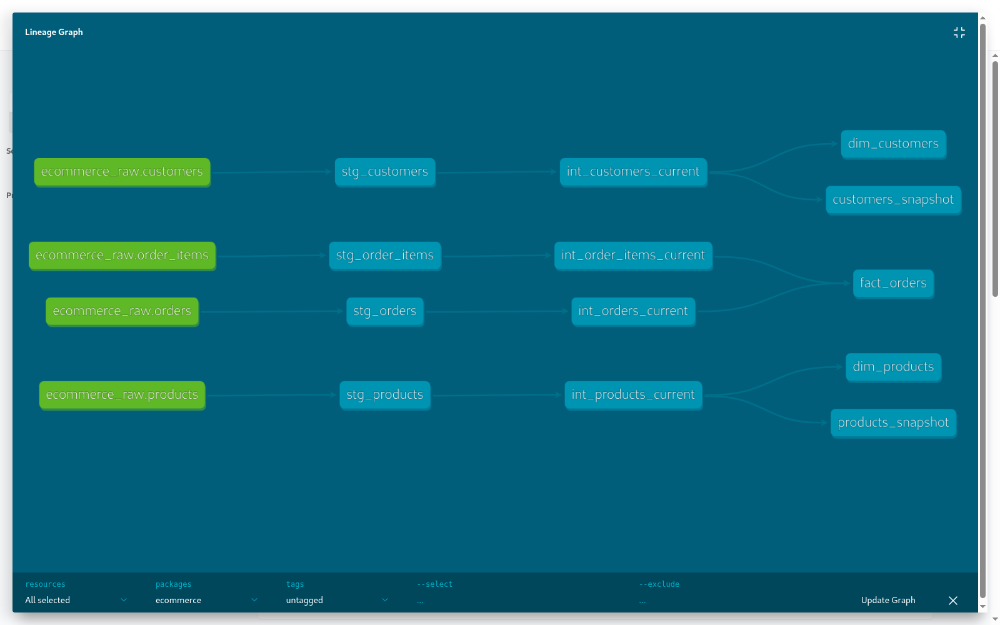
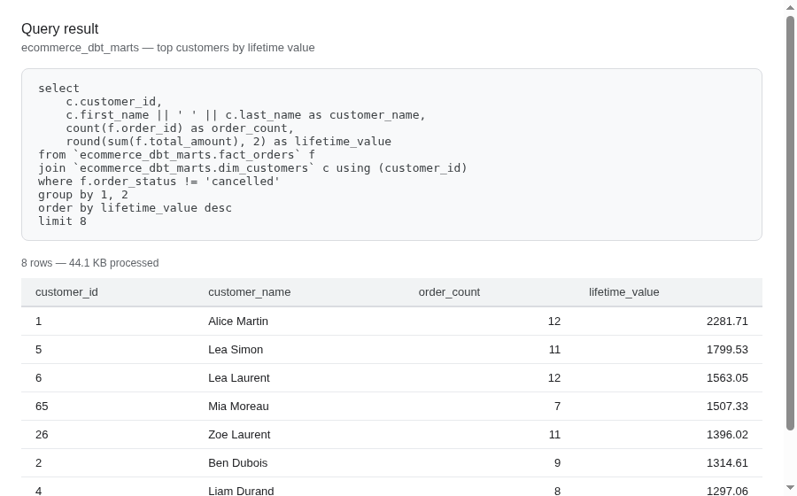

# ecommerce-cdc-analytics


Change data capture from a synthetic e-commerce Postgres database, through
Kafka/Debezium, into BigQuery, transformed with dbt (staging → intermediate
→ marts, with snapshots for slowly-changing dimension history).

Built as a portfolio project, one milestone at a time — see
[closed issues/PRs](../../issues?q=is%3Aissue+is%3Aclosed) for how it
came together.

## Architecture

```
Postgres (OLTP: customers, products, orders, order_items)
        │  WAL / logical replication
        ▼
Debezium Postgres connector (Kafka Connect)
        │  per-table CDC topics, JSON
        ▼
   Kafka (KRaft mode)
        │
        ▼
Python CDC→BigQuery loader (micro-batch consumer, append-only)
        │  raw_* tables: full CDC event log (op type + source ts preserved)
        ▼
  BigQuery (billing-enabled project)
     staging models (dbt) — typed/cleaned
        │
     intermediate models — collapse CDC log to current-row-per-key
     dbt snapshots — slowly-changing dimension history (customers/products)
        │
     marts — fact_orders, dim_customers, dim_products + dbt tests
```

## Status

All milestones complete.

- [x] M1 — CDC ingest: Postgres + Debezium + Kafka
- [x] M2 — Land in BigQuery
- [x] M3 — dbt staging + intermediate
- [x] M4 — dbt marts + tests
- [x] M5 — SCD history (dbt snapshots)
- [x] M6 — Polish

## What this demonstrates

- **CDC, not just batch/streaming ingestion**: Debezium reads Postgres's
  write-ahead log directly (`pgoutput` logical decoding), so every insert,
  update, and delete becomes a discrete event with a full before/after
  image - not a periodic poll-and-diff.
- **A real cloud warehouse, not a local stand-in**: BigQuery, with billing
  genuinely enabled (not just the free Sandbox) specifically because dbt's
  `MERGE`-based features (snapshots) need real DML - documented and
  verified, not glossed over.
- **dbt on a CDC source, not the usual batch-loaded table**: the
  interesting problem here isn't "write some SQL," it's that the raw layer
  is an append-only *event log*, not a table that already reflects current
  state. The `current_rows_by_key()` macro (window function, latest row
  per key, drop keys whose latest event is a delete) and the SCD2
  snapshots built directly off that log are the two places this project
  diverges from a typical dbt tutorial.
- **Verifying against the live system, not just "the command exited 0"**:
  every milestone's PR includes a check against the actual running
  Postgres/Kafka/BigQuery state - exact row-count/offset matching after
  draining the pipeline, field-for-field comparison on sampled rows,
  deliberately deleting a snapshotted entity to confirm history closes out
  correctly.
- **Reproducible by design, honestly scoped**: `docker compose up` on a
  bare clone gets the entire CDC half (Postgres → Debezium → Kafka)
  flowing with zero manual steps - verified on a genuinely fresh clone,
  not just "should work." The BigQuery/dbt half needs a one-time GCP setup
  that can't be scripted into a container, so it's documented separately
  rather than pretending otherwise.

## Running it

**Prerequisites:** Docker + Docker Compose for the CDC half (Postgres,
Kafka, Debezium). From M2 onward, a Google Cloud project with billing
enabled and the BigQuery API on — see
[docs/bigquery-setup.md](docs/bigquery-setup.md) (billing is required, not
just the free sandbox — dbt snapshots in M5 need DML, which Sandbox mode
blocks entirely; realistic usage at this project's scale stays well under
the free trial credit either way). Once that's done:

```
cp .env.example .env     # fill in GCP_PROJECT_ID
gcloud auth application-default login
docker compose up -d --build
```

`bq-loader` mounts your local Application Default Credentials
(`~/.config/gcloud/application_default_credentials.json`) read-only into
the container — no service account key to manage.

dbt transformations run separately against BigQuery (not inside
docker-compose) — see [dbt_project/](dbt_project/README.md).

Stop everything with:

```
docker compose down
```

### Local UIs

| Service          | URL                              |
|-------------------|-----------------------------------|
| Kafka UI (Kafbat)  | http://localhost:8085            |
| Kafka Connect REST | http://localhost:8083/connectors |

## Screenshots

dbt docs lineage graph — raw CDC sources through staging, intermediate,
snapshots, and marts:



A real query against the marts (top customers by lifetime value, joining
`fact_orders` and `dim_customers`):



## Design decisions

- **Debezium's `pgoutput` over a custom polling script**: logical
  replication gives exactly the operations that happened (including
  deletes, which a polling/diffing approach would miss or have to infer).
- **Load jobs over streaming inserts for `bq-loader`**: simpler, cheaper,
  and work regardless of billing status - streaming inserts are blocked
  in Sandbox mode anyway, and load jobs are the standard pattern for
  micro-batched CDC landing.
- **At-least-once landing into `ecommerce_raw`, not exactly-once**: a
  crash between a BigQuery load and the Kafka offset commit can reload a
  few rows. This is fine for an append-only raw log, since the
  intermediate layer already has to pick "latest row per key" regardless
  of whether the raw log has occasional duplicates.
- **dbt's native `snapshot` feature over a custom SCD2 query**: once
  billing unlocked `MERGE`, using the idiomatic dbt mechanism is more
  maintainable and more recognizable to anyone reviewing the project than
  a bespoke window-function equivalent would have been.
- **No Kubernetes/Terraform here**: this project's gap-filling targets were
  CDC, dbt, and a real cloud warehouse specifically; infra-as-code and
  orchestration are intentionally left for a future project rather than
  diluting this one's focus.

## License

MIT
